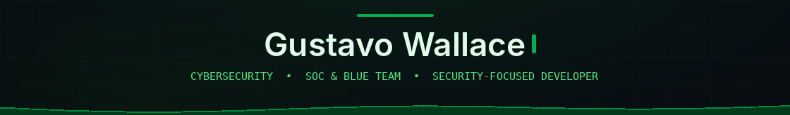

  

  <code>&gt; whoami</code> 
  Focused on defensive cybersecurity, building practical tools for data protection, security analysis, automation, and local AI.

  <code>&gt; featured_project</code> 
  <a href="https://github.com/Gustavo-Wallace/data-mask-studio"><strong>Data Mask Studio</strong></a> — Local-first data masking with an encrypted vault and controlled restoration.

  <code>&gt; toolkit</code> 
  

  <a href="https://github.com/Gustavo-Wallace/credentials">Credentials</a> ·
  <a href="https://tryhackme.com/p/YOUR_USERNAME">TryHackMe</a> ·
  <a href="https://www.linkedin.com/in/gustavo-wallace/">LinkedIn</a>

